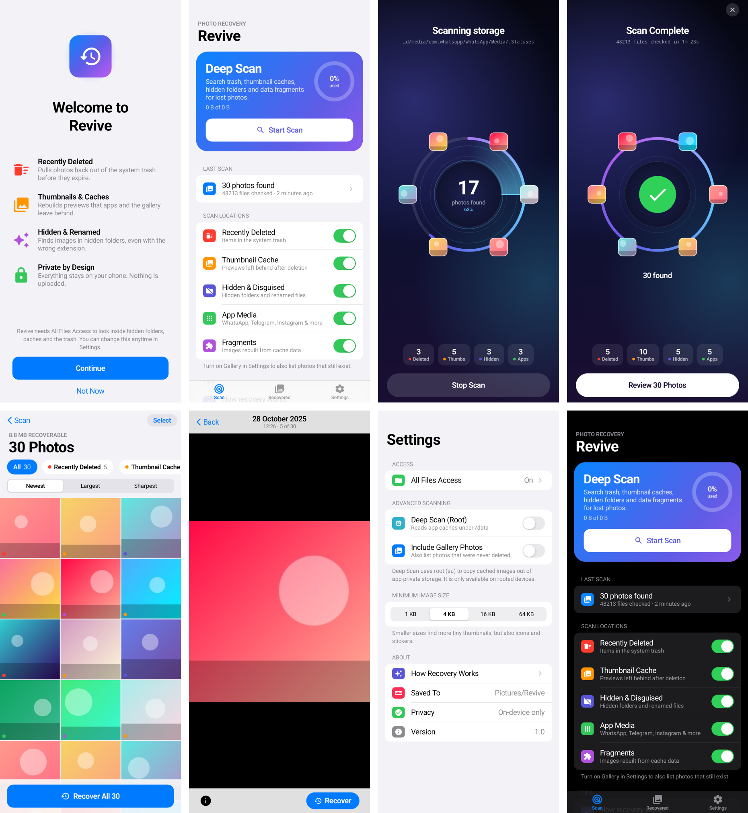

# Revive — Photo Recovery for Android

An Android app (Kotlin + Jetpack Compose) with an iOS-style interface that searches your phone for deleted and lost photos and restores them to your gallery.



## What it scans

| Source | What it finds |
|---|---|
| **Recently Deleted** | Photos in the Android 11+ system trash (`.trashed-*` files and MediaStore trashed items) |
| **Thumbnail Cache** | Previews in `.thumbnails` folders, plus previews packed inside thumbnail databases |
| **Hidden & Disguised** | Images in dot-folders and `.nomedia` folders, and images renamed with the wrong extension (detected by their magic bytes) |
| **App Media** | Copies kept by WhatsApp, Telegram, Instagram, Snapchat, Signal and other apps (including `Android/media`) |
| **Fragments** | JPEG/PNG images carved out of cache blobs and databases: the JPEG segment structure is parsed, and EXIF thumbnails are kept inside their parent image |
| **Deep Scan (root)** | On rooted phones, cached images in app-private storage (`/data/data/*/cache`, `files`, `app_*`) are copied out through `su`. Nothing under `/data` is modified |

Recovered photos are copied to **Pictures/Revive**, so they appear in every gallery app. Everything runs on the device. The app has no internet permission.

### Limits

Modern Android encrypts storage and releases a deleted file's space right away. A photo that was deleted, emptied from the trash, and has no thumbnail, cache or app copy left usually can't be recovered by any app. Scan as soon as possible after losing photos.

## UI

The design follows Apple's Human Interface Guidelines: system colors (light and dark), large collapsing titles, inset grouped lists with iOS switches, a sliding segmented control and a translucent tab bar. It also has spring press feedback, push/pop navigation transitions, an animated radar scanner with orbiting thumbnails, pinch-to-resize photo grids, and a Photos-style viewer with zoom and swipe-down to dismiss.

## Build

Requires JDK 17+ and the Android SDK (platform 35).

```bash
./gradlew assembleRelease        # app/build/outputs/apk/release/app-release.apk
./gradlew assembleDebug
./gradlew testDebugUnitTest --tests '*CarverTest'   # recovery-engine tests
./gradlew recordPaparazziDebug   # re-render UI screenshots (no device needed)
```

GitHub Actions (`.github/workflows/build-apk.yml`) builds both APKs on every push and uploads them as the `Revive-apk` artifact.

The release build is signed with the Android **debug** key, so it can be sideloaded directly. Use your own keystore before distributing it.

## Install

1. Copy `app-release.apk` to the phone and open it. Allow "Install unknown apps" when asked.
2. Open Revive, tap **Continue**, and turn on **Allow access to manage all files**.
3. Tap **Start Scan**.
