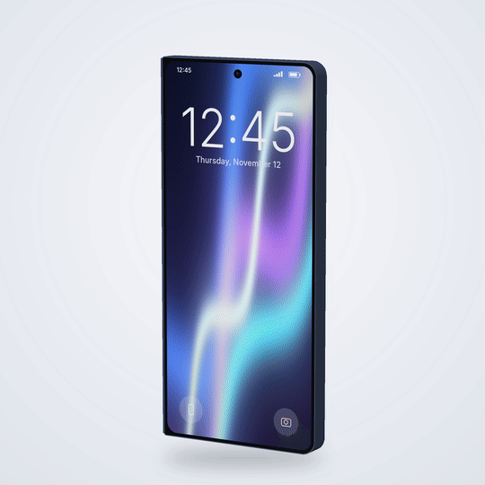

# Galaxy Z Fold7 – product images & fold animations

Illustrated product renders of a Galaxy Z Fold7-style book foldable, closed, open and every stage in between.
They use the real dimensions: 158.4 × 72.8 × 8.9 mm folded, 158.4 × 143.2 × 4.2 mm unfolded.



| File | Shows |
|---|---|
| `images/01-closed-front-cover-screen.png` | Closed, front: 6.5" cover screen |
| `images/02-closed-back-cameras.png` | Closed, back: triple camera |
| `images/03-open-front-main-screen.png` | Open flat: 8" main screen |
| `images/04-open-back.png` | Open, back side |
| `images/05-closed-three-quarter.png` | Closed, 3/4 view |
| `images/06-closed-back-three-quarter.png` | Closed back, 3/4 view |
| `images/07-half-open-folding.png` | Opened to 70° |
| `images/08-flex-mode-100deg.png` | Flex mode at 100° |
| `images/09-almost-open-unfolding.png` | Opened to 150° |
| `images/10-open-three-quarter-thin-profile.png` | Open, 3/4 view of the 4.2 mm profile |
| `images/11-closed-side-profile.png` | Closed, side profile |
| `images/12-fold-sequence-0-to-180.png` | 0° → 45° → 90° → 135° → 180° sequence |
| `images/13-colors-lineup.png` | Blue Shadow, Silver Shadow, Jetblack, Mint |
| `images/fold-animation.mp4` / `.gif` | Closed → open → closed loop (Blue Shadow) |
| `images/fold-animation-silver-shadow.mp4` / `.gif` | Same loop, Silver Shadow, mirrored angle |

The wallpapers, UI and app icons are original artwork. No Samsung logos or official assets are used.

## Regenerate

```bash
python3 render.py          # all images and animations
python3 render.py stills   # PNGs only
python3 render.py anim     # MP4 + GIF only (needs ffmpeg)
```

`render.py` is a small 3D renderer (numpy + Pillow) that you can edit. To add a view, add a line to `STILLS` (opening angle, yaw, pitch).
To add a colour, add an entry to `COLORWAYS`.
