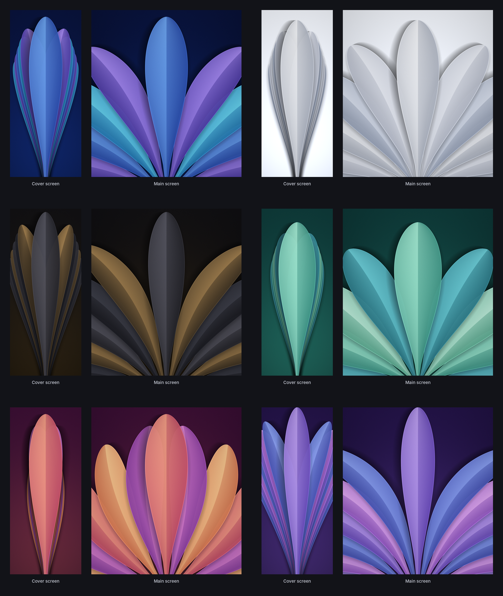

# Galaxy Z Fold7 wallpapers

Six original wallpaper sets made for the Galaxy Z Fold7. Each set is a matching pair:

- **Cover screen** (1080 × 2520): the petals are folded shut, like the phone.
- **Main screen** (1968 × 2184): the same bloom unfolds from the crease. The centre fold of the main petal sits on the screen's hinge.

Each set also has two video wallpapers:

- `cover.mp4`: the petals swing in and fold closed (3.5 s).
- `main.mp4`: the petals unfold out from the crease (4 s).

Each video ends on exactly the same picture as its still wallpaper, so the still and the video can be swapped.



| Folder | Set |
|---|---|
| `wallpapers/01-blue-bloom` | Blue Bloom |
| `wallpapers/02-silver-mist` | Silver Mist |
| `wallpapers/03-jet-night` | Jet Night |
| `wallpapers/04-mint-glass` | Mint Glass |
| `wallpapers/05-coral-dusk` | Coral Dusk |
| `wallpapers/06-violet-silk` | Violet Silk |

Each folder has `cover-1080x2520.png`, `main-1968x2184.png`, `cover.mp4`, `main.mp4` and `preview.png`.

## Setting them on the phone

1. Copy the folder to the phone, for example to `Pictures/`.
2. Go to **Settings → Wallpaper and style → Change wallpapers → Gallery**.
3. Set the main-screen file while the phone is open and the cover-screen file while it is closed.
   One UI asks which screen to apply to, or you can switch between **Main screen** and **Cover screen** at the top.
4. For the animated version, choose the `.mp4` in Gallery and apply it to the **Lock screen**.
   One UI plays video wallpapers on the lock screen only, and they can be up to 15 seconds long.

## Regenerate or customise

```bash
python3 wallpapers.py            # all stills and videos (needs numpy, Pillow, ffmpeg)
python3 wallpapers.py stills     # PNGs only
python3 wallpapers.py 01-blue-bloom
```

To make a new set, add an entry to `SETS` in `wallpapers.py`. You can set the colours, the number of petals, how far they spread, and how much they curl.
